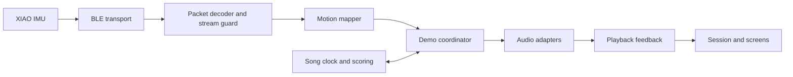

# Architecture and roadmap

Rehab Rhapsody's backend runs inside the Flutter app. Motion arrives over BLE,
the app maps it to musical actions, and bundled audio plays locally. The current
demo needs no server or account. See the [demo guide](demo-guide.md) for controls
and the [development guide](development.md) for setup and checks.

## Implemented data flow

| Component | Responsibility |
| --- | --- |
| `BatonTransport` / `UniversalBatonTransport` | Connection state, device selection, subscription, and rejection of late connection work |
| `MotionPacketDecoder` / `MotionStreamGuard` | Validate the 20-byte protocol, reject stale/duplicate frames, and handle sequence/timestamp wrap |
| `MotionMapper` | Filter tilt, choose a pitch, and detect rotation gestures for practice modes |
| `DemoController` | Coordinate session state, target detection, motion freshness, note commands, and stream loss |
| `HomeController` | Preferences, practice timer, and confirmed current-note display |
| `SongGame` | Deterministic note judgment, score, combo, misses, and results |
| `SongSession` | Synchronize the chart with backing audio, pause/reset, and reject stale asynchronous work |
| Audio interfaces/adapters | Prepare bundled samples, play foreground notes/backing music, and handle interruptions |

Transport and audio interfaces allow tests to supply packets and playback events
without a radio or speaker. Song scoring takes an explicit position and has no
independent clock. Platform effects remain in their adapters.

## Hardware and protocol

The **Seeed Studio XIAO nRF52840 Sense** uses its onboard six-axis IMU. The
non-mbed **Seeed nRF52 Boards 1.1.13** core is the verified Arduino setup.
Use the [firmware guide](../firmware/README.md) to install dependencies and the
[BLE protocol](../firmware/ble-motion.md) for UUIDs, byte layout, units, and scaling.
The USB diagnostic sketch is a separate bring-up tool, not the app transport.

The board sends raw acceleration and angular velocity with a version, sequence,
and timestamp. Filtering, musical pitch selection, and scoring happen in the
app. MIDI 60 is displayed as C4; the demo samples span the eight C-major notes
from C4 through C5. Drums are tuned percussion using that same pitch range.

The user confirmed USB readings and LightBlue BLE notifications. Five real
packets are retained as a decoder fixture. Their observed cadence is about
16.7 Hz; the firmware's 50 Hz loop target is not a measured delivery guarantee.
Stationary bias, mounting orientation, end-to-end latency, and reconnect behavior
still need physical acceptance.

## Playback and lifecycle rules

- Songs plays the target pitch automatically while fresh valid motion is inside
  the target zone. The band is 10% wide, with its center adjustable from 5-95%.
  It represents filtered tilt, not physical hand height.
- Automatic song hits occur at or after onset, up to 280 ms late, once per note.
  Holding in the zone can hit successive notes. Manual taps use a 280 ms window
  on either side of onset.
- Free play and Guided use rotation onset/release hysteresis; Rhythm uses the
  selected tempo while recent motion is active. Song tempos remain fixed to
  match their generated backing tracks.
- Playback prepares and reuses 32 instrument samples. Foreground notes are
  monophonic; a newer note or stop supersedes the previous voice.
- The current-note label follows an accepted audio command. It does not claim
  microphone verification of audible output. Session and voice identifiers
  prevent delayed callbacks from reviving a stopped note.
- Audio position drives song progress, with bounded interpolation. Stalled
  backing audio pauses the song. Old motion cannot keep scoring new notes.
- Opening settings, pausing, backgrounding, disconnecting, stream timeout, or
  audio interruption stops/pauses playback. Returning to the app or reconnecting
  never resumes a session automatically.
- Preferences, target position, and results are in memory. Song resets preserve
  target settings; closing the app does not save them.

The fixed play workspace and separate settings pages keep controls visible on
phone screens. Layout tests cover small phones, safe areas, larger text, and
touch target sizes. Device testing remains necessary for native behavior.

## Next milestones

1. **Physical app acceptance.** Connect the actual baton to the app and verify
   sound, sustained target hits, permission denial, loss of signal, reconnect,
   backgrounding, and phone audio interruptions. Measure latency and delivery
   cadence. A Mac is needed to build the native iPhone app.
2. **Calibration.** Record stationary samples and mounting orientation; define
   comfortable movement ranges with the rehabilitation team. The demo's tilt
   mapping and adjustable target are not patient-specific calibration.
3. **Persistent settings and sessions.** Decide which preferences and session
   summaries to save, including how reset/discard should behave. Start with a
   local repository; keep raw sensor recordings only for a defined requirement.
4. **Gameplay and usability.** Observe patients using song selection, target
   setup, feedback, and recovery after pauses. Add progression and more music
   after validating the basic loop and documenting music rights.
5. **Shared history, if needed.** Therapist access or cross-device history would
   introduce authentication, data ownership, retention, and synchronization.
   Choose a cloud service only once those product requirements are defined.

Automated tests and the browser smoke suite cover logic and simulated device
flows. They do not replace the [physical acceptance checks](demo-guide.md#validation-and-remaining-work).
